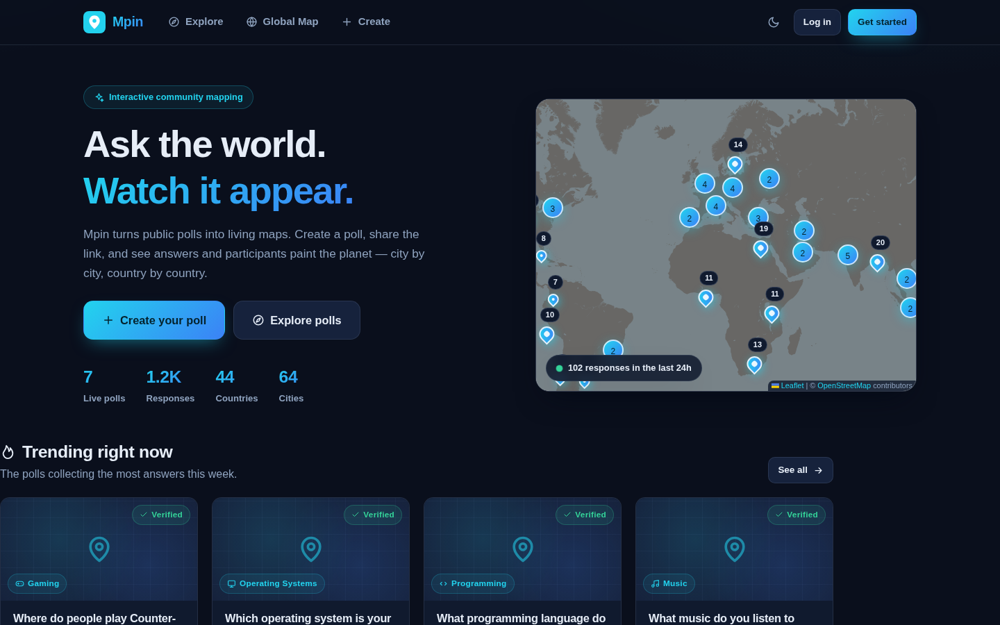
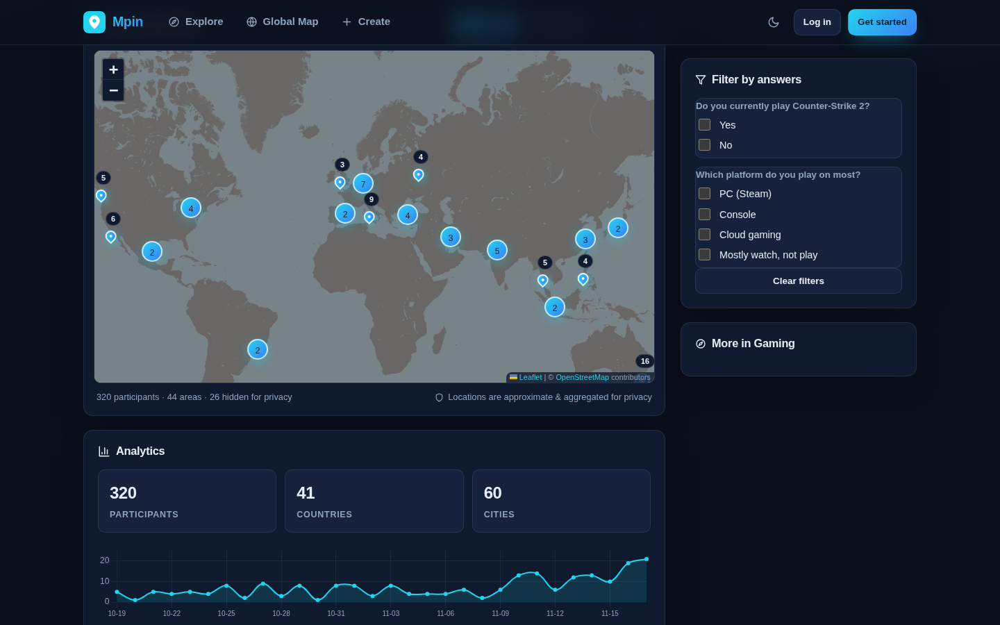
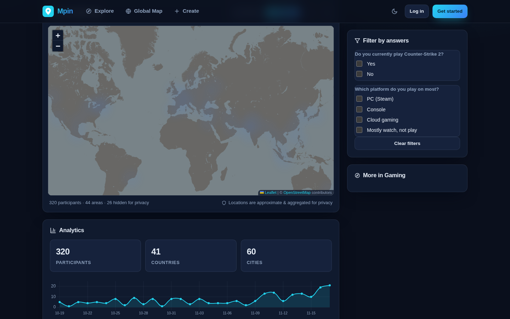
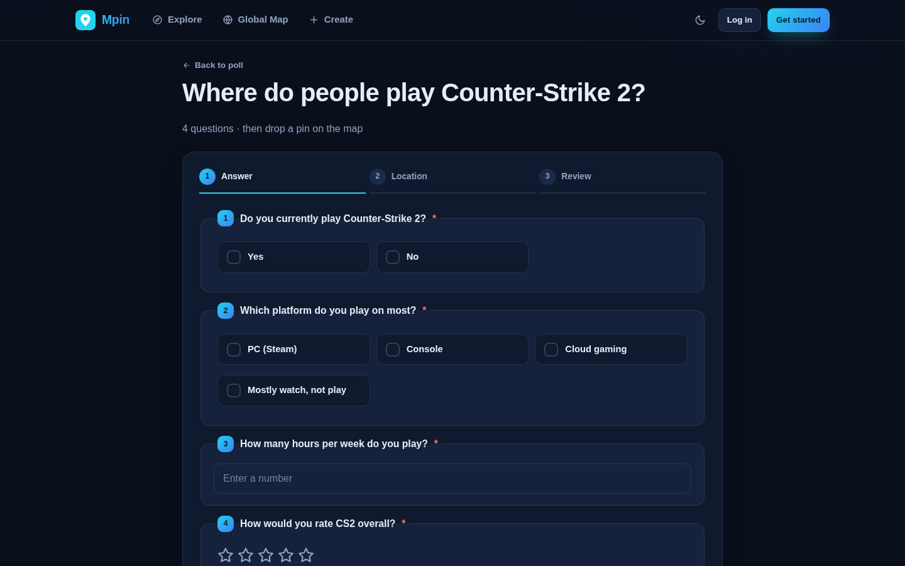
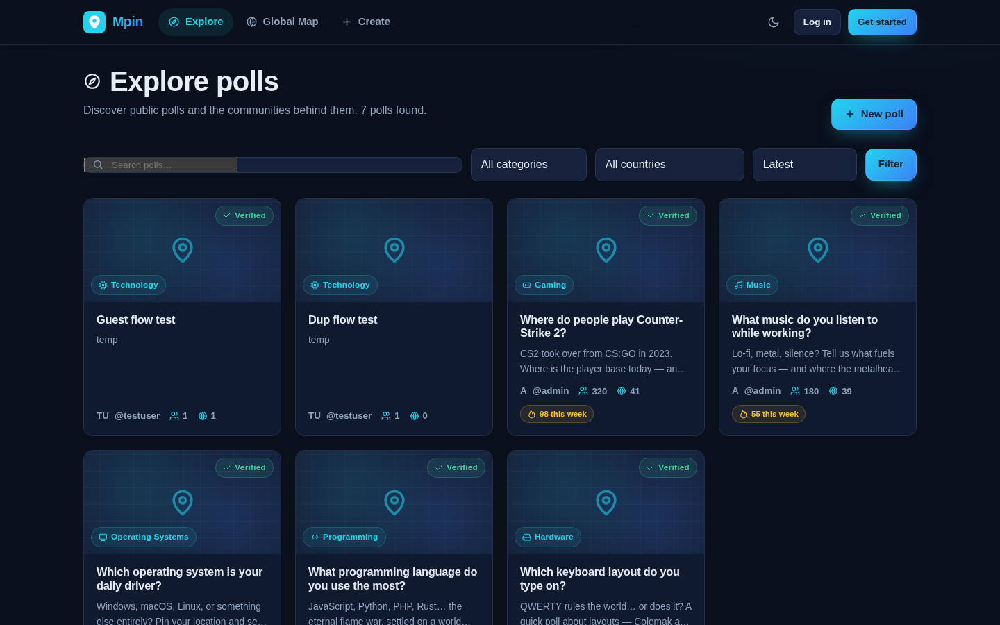
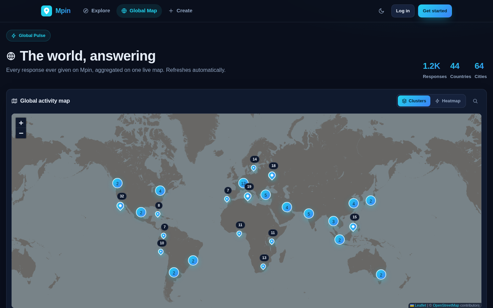
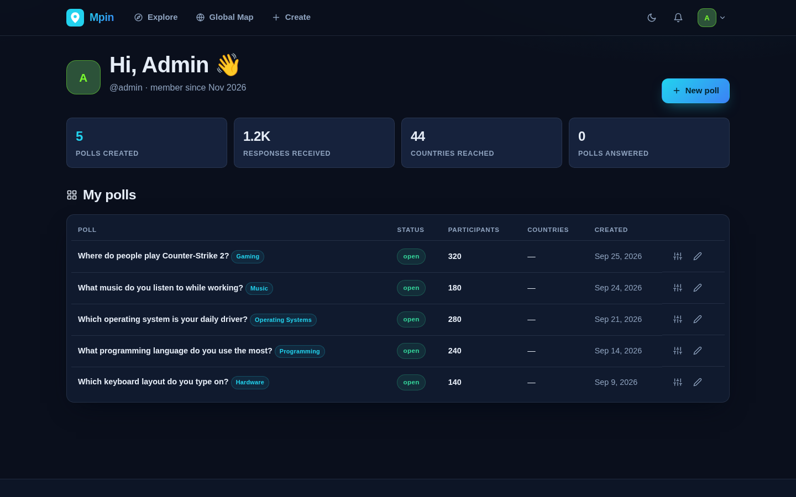
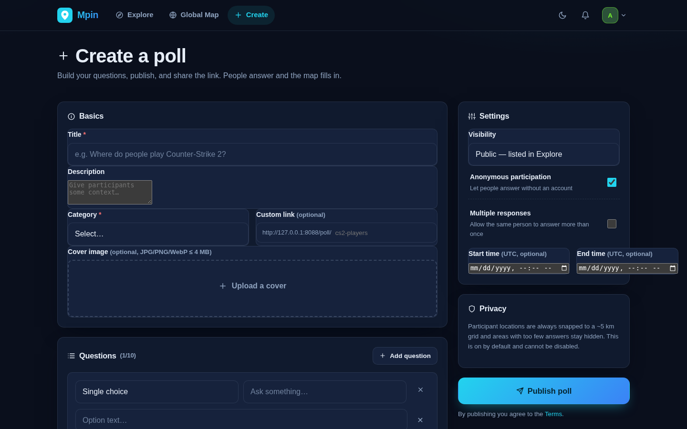
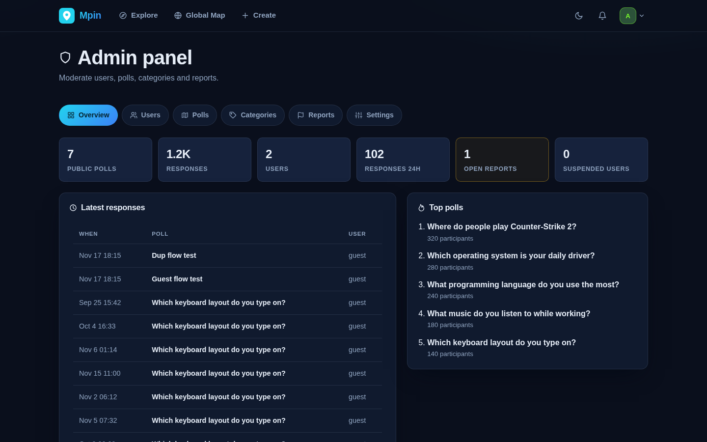
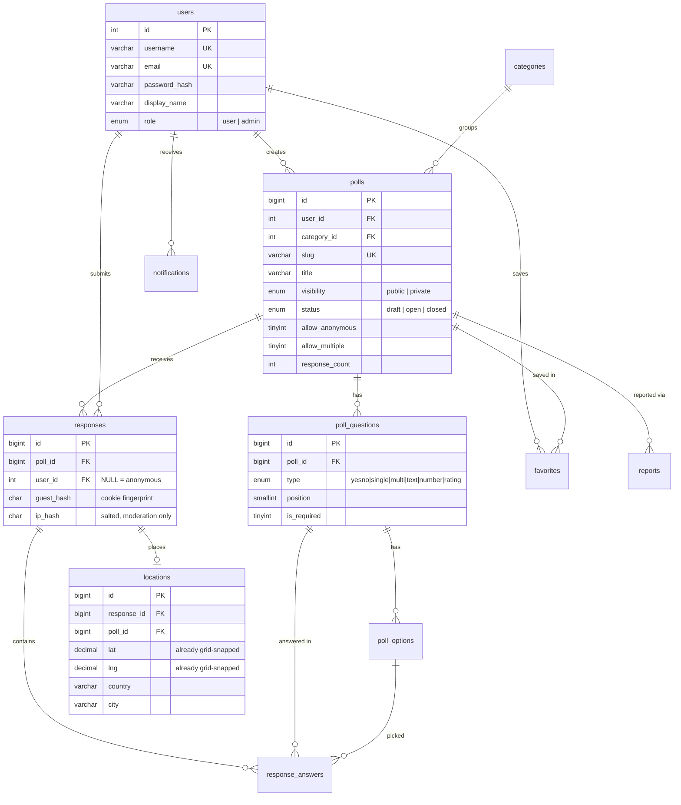

<div align="center">


# Mpin — Interactive Community Mapping & Polling Platform

**People Answer. The World Appears.**

[](https://mpin.metora.ir/)
[](https://php.net)
[](https://www.mysql.com)
[](https://leafletjs.com)
[](https://www.chartjs.org)
[](#-install-on-cpanel)
[](LICENSE)

Create a poll → share the link → watch answers paint a live world map.

Mpin turns simple questions into living, geographic visualisations — every participant can drop an
approximate pin, and the results grow into clusters, heatmaps and country rankings in real time.

**[Live demo →](https://mpin.metora.ir/)** · **[Explore polls →](https://mpin.metora.ir/explore)** · **[The global map →](https://mpin.metora.ir/map)**

</div>

---

## 📸 A look inside

| Home — the world, at a glance | Poll — live results map |
|:---:|:---:|
|  |  |

| Heatmap mode | Participate — answer & drop a pin |
|:---:|:---:|
|  |  |

| Explore | Global Pulse |
|:---:|:---:|
|  |  |

| Dashboard | Create a poll | Admin panel |
|:---:|:---:|:---:|
|  |  |  |

*Dark mode is the default; a light theme is one click away.* ☀️🌙

---

## 💡 Why Mpin?

Normal polls give you a bar chart. Mpin gives you the **world**.

Ask *"Where do people play Counter-Strike 2?"* and an hour later you have a map showing players
clustering in Tehran, Berlin and São Paulo — filterable by platform, skill rating or hours played.
Ask which operating system people use, and watch Linux concentration glow across continents.

Mpin is built to become a global platform for participatory knowledge: **every question becomes a
geographic dataset, and every answer becomes a point of light on the map.**

### How it works

```
1. CREATE      Ask anything — yes/no, single or multiple choice, ratings, numbers, short text.
     ↓
2. SHARE       Every poll gets a clean link:  mpin.metora.ir/poll/cs2-players
     ↓
3. ANSWER      Participants reply (no account needed for public polls) and optionally
     ↓         drop an approximate pin on the map.
4. WATCH       Clusters, heatmap, charts, growth and country rankings — updating live.
```

---

## ✨ Features

### 🗺️ Interactive map (the heart of Mpin)
- **Marker clustering** — thousands of answers collapse into smooth, animated clusters
- **Heatmap mode** — one click switches to a glowing intensity view
- **Answer filters** — filter the map by any choice question ("show only PC players")
- **Live updates** — new answers appear without a page reload (AJAX polling)
- **Place search** — fly to any city or country (Nominatim / OpenStreetMap)
- **Aggregated popups** — see how many people pinned near a city

### 📊 Polls & questions
- Question types: **Yes/No · Single choice · Multiple choice · Short text · Number · Rating (1-5)**
- Up to 10 questions per poll, each individually required/optional
- Number questions support min/max validation
- Public polls (listed in Explore) or private (link-only)
- Optional schedule (start/end time), anonymous participation, single vs. repeat answers
- Custom slugs (`/poll/cs2-players`), cover images, editing, closing and deleting by the owner

### 🧭 Explore
- Latest / Most popular / Trending (last 7 days) sorting
- Full-text search, category and country filters
- 10 seeded categories: Gaming, Technology, Programming, Operating Systems, Hardware, Music, Lifestyle, Education, Communities, Other
- Live "trending this week" badges

### 📈 Analytics
- Total participants, countries and cities reached
- Participation growth line chart (30 days)
- Per-question results: bars, rating distribution with average, number histograms, recent text answers
- Top-10 countries and cities
- CSV / JSON export for poll owners

### 👤 Accounts & dashboard
- Registration / login with remember-me, password change, profile & bio
- Dashboard: your polls, polls you answered, responses & countries reached, saved polls
- Public profiles at `/u/{username}`
- Notifications when someone answers your poll
- **Privacy self-service**: delete all your responses with one click

### 🛡️ Admin panel
- Site-wide stats, recent activity, top polls
- User management (suspend, promote, delete)
- Poll moderation (feature ★, verify ✔, close, delete)
- Category manager, report queue, site settings

---

## 🔒 Privacy by design

Location data is powerful — so Mpin treats it with care by default:

| Protection | How it works |
|---|---|
| **~5 km privacy grid** | Coordinates are snapped to a 0.05° grid with a deterministic offset *before* they are ever stored — the exact point is discarded |
| **k-anonymity** | Map areas with fewer than 3 responses are suppressed and never sent to the browser |
| **Opt-in only** | Dropping a pin is always a choice; GPS is only read with explicit browser permission |
| **No IP storage** | IPs are stored only as salted one-way hashes, used for spam protection and de-duplication |
| **Erasure** | Any user can delete all of their responses (answers + map pins) from Settings → Privacy |
| **Safe API** | The public API only ever returns aggregated cells — never individuals |

---

## 🧱 Tech stack

| Layer | Technology |
|---|---|
| Backend | **PHP 8+** — no framework, no build step, ~100% shared-hosting friendly |
| Database | **MySQL / MariaDB** via PDO, prepared statements everywhere |
| Frontend | Vanilla **HTML5 / CSS3 / JavaScript (ES6+)** + AJAX |
| Maps | **Leaflet.js**, Leaflet.markercluster, leaflet.heat, OpenStreetMap tiles |
| Charts | **Chart.js 4** |
| Server | Apache with `mod_rewrite` (standard cPanel setup) — no Node.js, no VPS, no WebSockets |

**Security:** CSRF tokens on every POST · prepared statements against SQL injection ·
output escaping against XSS · rate limiting (login, registration, responses, reports) ·
honeypot fields · session hardening (httponly, SameSite, regeneration) ·
upload re-encoding (GD) · `.htaccess` protection of private paths.

---

## 📁 Project structure

```
mpin/
├── index.php                  # Front controller (router)
├── .htaccess                  # Pretty URLs + security headers + access rules
├── schema.sql                 # Full MySQL schema
├── install/                   # Web installer (+ demo data seeder)
│   ├── index.php
│   └── seed.php
├── app/
│   ├── bootstrap.php          # Config, autoloader, session, error handling
│   ├── config.sample.php      # Copy to app/config.php
│   ├── routes.php             # Route table
│   ├── Core/                  # Router, Database, Auth, Csrf, RateLimiter,
│   │                          # Validator, View, helpers
│   ├── Controllers/           # Home, Explore, Poll, Participate, Create, Auth,
│   │                          # Dashboard, Profile, Settings, Admin, Api
│   ├── Models/                # Poll, User, Category, ResponseModel
│   └── Views/                 # Layout + templates (no engine, plain PHP)
├── assets/
│   ├── css/app.css            # Design system (dark + light themes)
│   ├── js/                    # app.js core + per-page scripts
│   ├── img/                   # Logo & favicon (SVG)
│   └── vendor/                # Leaflet, markercluster, leaflet.heat, Chart.js
├── uploads/                   # Poll cover images (PHP execution blocked)
├── storage/                   # Logs (web access blocked)
└── docs/screenshots/          # The images you see above
```

---

## 🚀 Installation

### On cPanel (shared hosting) — the intended target

1. **Upload** — copy everything from this repository into your domain's document root
   (e.g. `public_html/`), via File Manager → Upload (zip) → Extract, or FTP.
2. **Create a database** — in cPanel open *MySQL® Databases*, create a database and a user,
   and grant the user all privileges on that database.
3. **Run the installer** — visit `https://your-domain.com/install/`, fill in the database
   credentials, your admin account, and press **Install**. Optionally keep *demo content*
   checked to start with 5 sample polls and ~1,200 worldwide answers.
4. **Delete `install/`** — the installer reminds you, and locks itself, but removing the
   folder is the safe move.
5. Done — log in at `/login` and create your first poll. 🎉

> Requirements: PHP 8.0+ with `pdo_mysql`, `mbstring`, `gd`, `fileinfo`
> (standard on every current cPanel host), one MySQL database, `mod_rewrite` (on by default).

### Locally (PHP built-in server)

```bash
git clone https://github.com/Daronely/Mpin.git
cd Mpin

# create the database
mysql -u root -e "CREATE DATABASE mpin CHARACTER SET utf8mb4 COLLATE utf8mb4_unicode_ci"

# serve it — then open http://localhost:8088/install/
php -S localhost:8088 index.php
```

The installer writes `app/config.php` for you. To go manual instead: copy
`app/config.sample.php` → `app/config.php`, import `schema.sql`, and set `env` to
`development` for verbose errors.

---

## ⚙️ Configuration

`app/config.php` (generated by the installer, excluded from git):

```php
return [
    'app' => [
        'url' => 'https://mpin.example.com',  // public base URL
        'key' => '…64 random hex chars…',      // salts IP hashes & cookies
        'env' => 'production',                 // or 'development'
        'timezone' => 'UTC',
        'trust_proxy' => false,                // true behind Cloudflare etc.
    ],
    'db' => [ 'host' => 'localhost', 'port' => 3306,
              'name' => 'mpin', 'user' => '…', 'pass' => '…', 'charset' => 'utf8mb4' ],
    'privacy' => [
        'grid' => 0.05,   // snap grid in degrees (~5.5 km)
        'min_cell' => 3, // k-anonymity threshold for map cells
    ],
];
```

---

## 🔌 Public REST API

All endpoints return JSON. POST endpoints require the `X-CSRF-Token` header
(the token lives in the `<meta name="csrf-token">` tag of any page).

| Method | Endpoint | Description |
|---|---|---|
| `GET` | `/api/stats` | Global counters (polls, responses, countries, cities, users) |
| `GET` | `/api/polls` | Public polls — `?sort=latest\|popular\|trending&q=&category=&country=&page=` |
| `GET` | `/api/polls/{slug}` | Single poll card |
| `GET` | `/api/polls/{slug}/map` | Aggregated map points — `?f{questionId}={optionIds}` filters |
| `GET` | `/api/polls/{slug}/results` | Full analytics payload |
| `POST` | `/api/polls/{slug}/responses` | Submit answers + optional location |
| `GET` | `/api/map/global` | Aggregated points across all public polls |
| `GET` | `/api/countries` | Countries with response counts |
| `POST` | `/api/auth/login` · `/api/auth/register` · `/api/auth/logout` | Session auth |
| `GET` | `/api/me` | Current user |
| `POST` | `/api/favorites/{pollId}/toggle` | Save / unsave a poll |
| `POST` | `/api/reports` | Report a poll (`spam`, `abuse`, `fake`, `privacy`, `other`) |

Example — submit a response:

```bash
curl -X POST https://mpin.metora.ir/api/polls/cs2-players/responses \
  -H "Content-Type: application/json" \
  -H "X-CSRF-Token: <token>" \
  -d '{"answers":{"1":{"option_id":1},"2":{"option_id":3},"3":{"number":10},"4":{"rating":5}},
       "location":{"lat":52.52,"lng":13.40,"city":"Berlin","country":"Germany"}}'
```

---

## 🗄️ Database schema



---

## 🗺️ Roadmap

Mpin's architecture already anticipates these — they are intentionally out of the v1 scope:

- [ ] **Global Pulse** dashboards with per-country leaderboards
- [ ] **Live participation** — new pins animate onto the map within seconds (SSE / short polling)
- [ ] **Embeddable maps** — drop a poll's map into any website with an `<iframe>`
- [ ] **Poll collections** — bundle related polls into a series
- [ ] **Verified creators** — badge program for trusted organizations
- [ ] **Comments & reactions** under polls
- [ ] **Public dataset API** with stable identifiers + per-key rate limits

---

## 🤝 Contributing

Issues and pull requests are welcome. The codebase is deliberately small and framework-free —
start in `app/routes.php`, follow a controller, and you already know the whole architecture.

```bash
# run the test suite against a local install (adjust paths inside the script)
python3 scripts/api_test.py
```

---

## 👤 Author

<div align="center">

**Amir — [@Daronely](https://github.com/Daronely)**

Building the map of what the world thinks.

[](https://t.me/daronelydev)
[](https://github.com/Daronely)
[](tel:+98999960295)
[](https://mpin.metora.ir/)

</div>

---

## 📄 License

Released under the [MIT License](LICENSE).

Map data © OpenStreetMap contributors · Tiles by OpenStreetMap ·
Geocoding by Nominatim · Charts by Chart.js · Maps by Leaflet

<div align="center">

**Mpin — People Answer. The World Appears.** 🌍📍

⭐ Star the repo if you like the idea — it helps more than you think.

</div>
